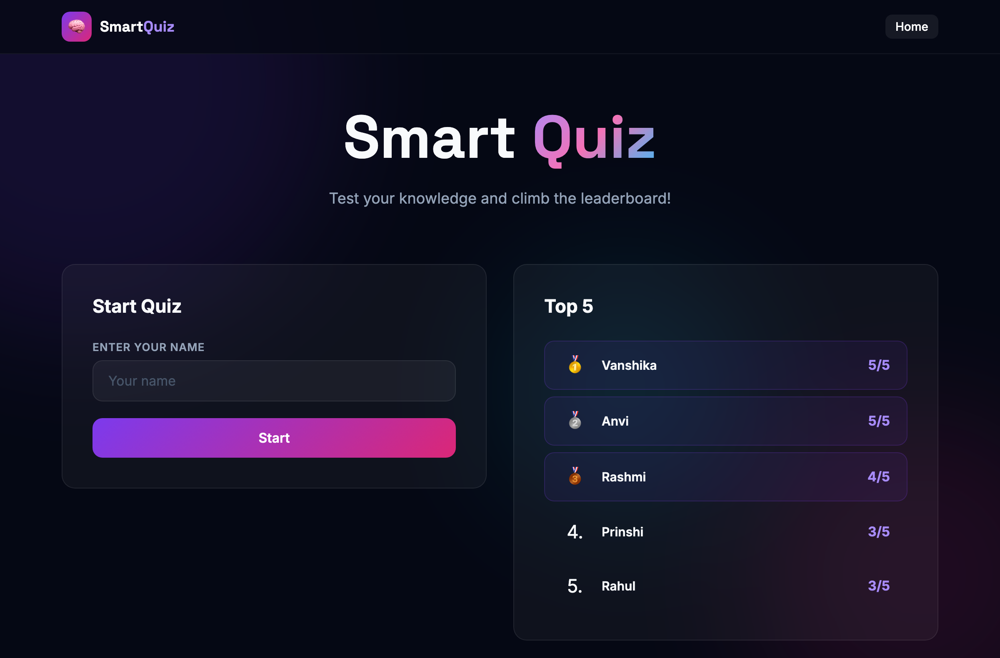
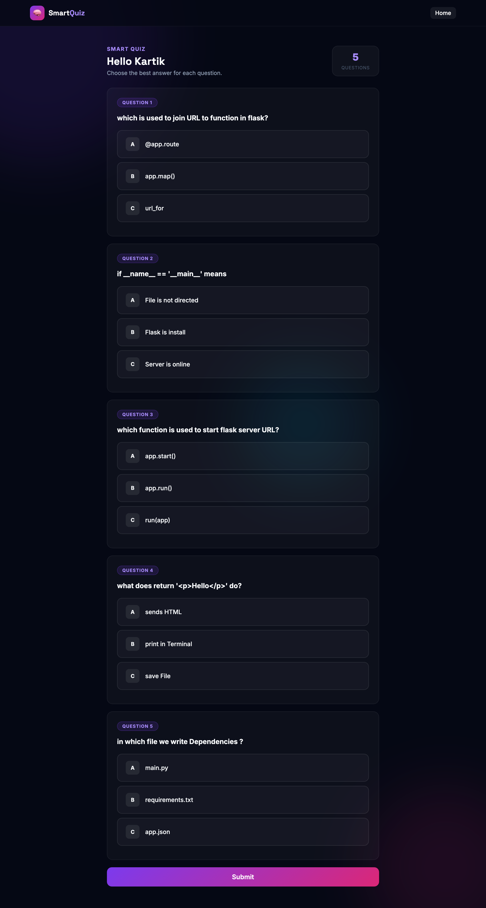
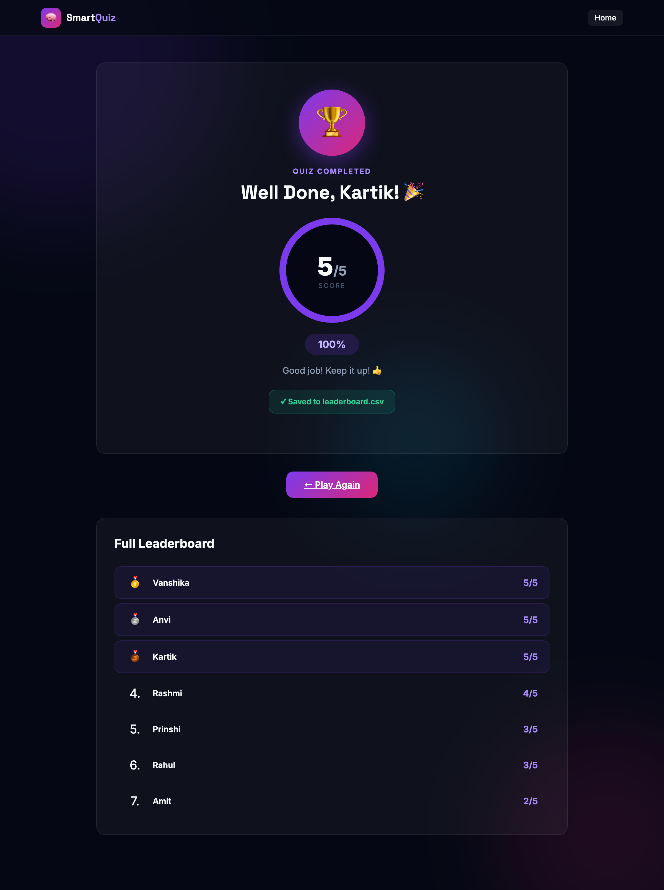

# 🧠 Smart Quiz with Leaderboard

A **Flask web application** that conducts a quiz, scores answers **instantly**, and ranks players on a **leaderboard**. Questions and scores are stored in simple **CSV files** — no database setup required.

> **Mini Project** by **Prabudh Gautam** & **Kartik Sharma**

---

## 📖 Description

**Smart Quiz with Leaderboard** is a lightweight quiz platform built with the exact tech stack described in our presentation: **Python 3 + Flask + the `csv` and `os` modules + HTML/CSS**. A player enters their name, answers a set of multiple-choice questions loaded from `questions.csv`, and gets an immediate score. The result is saved to `leaderboard.csv`, and the **Top 5 players** are shown on the home page.

The whole app is intentionally simple and dependency-light: a single `app.py` server, two CSV files, and a set of HTML templates with a clean dark card UI.

---

## 🖼️ Screenshots

### 🏠 Home Page — enter your name & see the Top 5


### 📝 Quiz Page — questions loaded from CSV as radio buttons


### 🏆 Result Page — instant score, full leaderboard & Play Again


---

## ❗ Problem Statement

Conducting quizzes the traditional way is **slow, manual, and not very engaging**:

| Problem | Why it matters |
|---|---|
| **Manual evaluation** | Answer sheets must be checked by hand — slow and error-prone. |
| **No instant result** | Players wait for the checker before knowing how they did. |
| **No competition** | Without a ranking there is little motivation to improve or replay. |
| **Hard to update** | Changing questions usually means editing code or reprinting papers. |

---

## 🎯 Objective

1. **Build a simple quiz website** — a player enters a name and starts.
2. **Keep questions editable** — loaded from `questions.csv`, no code changes needed.
3. **Score automatically** — compare every answer and show the score instantly.
4. **Maintain a leaderboard** — save scores in `leaderboard.csv` and show the Top 5 on the home page.

---

## 🛠️ Tech Stack

| Technology | Role |
|---|---|
| **Python 3** | Core programming language |
| **Flask** | Web framework — routing, `request`, `redirect`, templates |
| **`csv` module** | Stores questions and scores |
| **`os` module** | Checks whether files exist / builds file paths |
| **HTML** | Quiz form and result pages |
| **CSS** | Dark card styling |

**Editor:** Visual Studio Code

---

## 🔄 How It Works (Flow)

```
 ┌────────────┐   ┌────────────┐   ┌────────────┐   ┌──────────────┐   ┌───────────────┐
 │  Home  /   │ → │  Quiz      │ → │  Submit    │ → │  Save score  │ → │  Result page  │
 │  Enter     │   │  /quiz     │   │  /submit   │   │  save_board()│   │  score + full │
 │  name,     │   │  questions │   │  answers   │   │  name,score  │   │  leaderboard, │
 │  see Top 5 │   │  as radios │   │  checked   │   │  appended    │   │  Play Again   │
 └────────────┘   └────────────┘   └────────────┘   └──────────────┘   └───────────────┘
        ↑                                                                        │
        └──────────────────────  Play Again returns home  ──────────────────────┘
```

1. **Home `/`** — enter your name and see the Top 5.
2. **Quiz `/quiz`** — questions load from the CSV as radio buttons.
3. **Submit `/submit`** — answers are checked and the score is counted.
4. **Save score `save_board()`** — the name and score are appended to the CSV.
5. **Result page** — score, full ranking, and a **Play Again** link.

---

## 🚀 Setup & Run

### Prerequisites
- **Python 3.8+** installed (`python3 --version`)
- **pip** (`python3 -m pip --version`)

### 1. Clone / open the project
```bash
cd smart-quiz
```

### 2. Create a virtual environment (recommended)

**macOS / Linux**
```bash
python3 -m venv venv
source venv/bin/activate
```

**Windows (PowerShell)**
```powershell
python -m venv venv
venv\Scripts\Activate.ps1
```

### 3. Install dependencies
```bash
pip install -r requirements.txt
```

### 4. Start the server
```bash
python3 app.py
```
or use the helper script:
```bash
./run_flask.sh
```

You should see:
```
Starting Smart Quiz Flask Server on http://127.0.0.1:5000 ...
 * Running on http://127.0.0.1:5000
```

### 5. Open in your browser
👉 **http://127.0.0.1:5000**

> **Note:** With `debug=True`, the server auto-reloads when you edit files. Stop it with `Ctrl + C`.

---

## 🎮 How to Play

1. On the **home page**, type your name and click **Start**.
2. Answer each question by selecting **A**, **B**, or **C**.
3. Click **Submit**.
4. See your **instant score**, your position on the **full leaderboard**, and click **Play Again** to replay.

---

## 🗂️ Project Structure

```
smart-quiz/
├── app.py                 # Flask server — all routes & functions
├── questions.csv          # Quiz questions  (q,a,b,c,ans)
├── leaderboard.csv        # Player scores   (name,score)
├── requirements.txt       # Python dependencies
├── run_flask.sh           # Convenience run script
├── README.md
├── screenshots/           # UI screenshots used in this README
│   ├── home.png
│   ├── quiz.png
│   └── result.png
├── templates/             # Jinja2 HTML templates
│   ├── base.html          # Shared layout (navbar, background, fonts)
│   ├── index.html         # Home page
│   ├── quiz.html          # Quiz page
│   └── result.html        # Result page
└── static/
    └── style.css          # Dark theme card styling
```

---

## 🧩 Routes & Functions

| Route | Method | Purpose |
|-------|--------|---------|
| `/` | `GET`, `POST` | Home — enter name & show Top 5. `POST` redirects to `/quiz?name=…` |
| `/quiz` | `GET` | Load questions from the CSV and render radio buttons |
| `/submit` | `POST` | Score the answers, save the score, show the result |

**Core functions in `app.py`:**

- **`load_questions()`** — reads `questions.csv`; falls back to built-in default questions if the file is missing; cleans each row with `.strip()`.
- **`load_board()`** — reads `leaderboard.csv` and sorts scores **high → low**.
- **`save_board(name, score)`** — appends a new `name, score` row to `leaderboard.csv`.
- **`app.run(debug=True)`** — starts the development server.

**Dynamic scoring:** the total is computed as `len(questions)`, so the score is shown as `/{len(questions)}` instead of a hardcoded `/5`. Add 10 questions to the CSV and the score automatically becomes `/10`.

---

## 📄 Data Files

### `questions.csv`
One question per row, with three options and the correct answer letter.

```csv
q,a,b,c,ans
which is used to join URL to function in flask?,@app.route,app.map(),url_for,a
if __name__ == '__main__' means,File is not directed,Flask is install,Server is online,c
which function is used to start flask server URL?,app.start(),app.run(),run(app),b
what does return '<p>Hello</p>' do?,sends HTML,print in Terminal,save File,a
in which file we write Dependencies ?,main.py,requirements.txt,app.json,b
```

- `q` — the question text
- `a`, `b`, `c` — the three answer options
- `ans` — the correct option letter (`a`, `b`, or `c`)

> ✏️ **To change the quiz, just edit this file — no code changes needed.**

### `leaderboard.csv`
One player per row. New scores are appended automatically.

```csv
Prabudh,5
Kartik,4
Rahul,3
```

- `name` — the player's name
- `score` — their score

> ♻️ To reset the leaderboard, delete all rows (or the whole file) and it will be recreated.

---

## ✨ Key Features

1. **Web-Based** — runs in any browser, with no installation required for the user.
2. **Instant Result** — the score is calculated and displayed immediately after submission.
3. **CSV Integration** — questions and leaderboard are handled through CSV files, so no database setup is needed.
4. **Dynamic Scoring** — the hardcoded `/5` was replaced with `/{len(questions)}`, so adding questions automatically updates the total.
5. **Clean & Responsive UI** — a dark theme card layout that is simple and user-friendly.

---

## 🔭 Future Scope

- **Database storage** — move from CSV files to SQLite or MySQL.
- **User login** — secure accounts so each player has a profile.
- **Timer** — a countdown for each question or the whole quiz.
- **Categories and levels** — topics with easy, medium, and hard difficulty.
- **Admin panel** — add and edit questions from the browser.
- **Online deployment** — host the app so anyone can play from anywhere.

---

## 🌿 Git Branches

- **`main`** *(default)* — the exact **Python Flask + CSV** version matching the presentation.
- **`flask-version`** — dedicated branch tracking the **Flask + CSV** implementation.
- **`nextjs-version`** — the full-stack **Next.js 16 + React 19 + TypeScript** implementation.

---

## 👥 Authors

- **Prabudh Gautam**
- **Kartik Sharma**

---

## 📜 License

This project was created for academic/mini-project purposes. Free to use and modify for learning.
